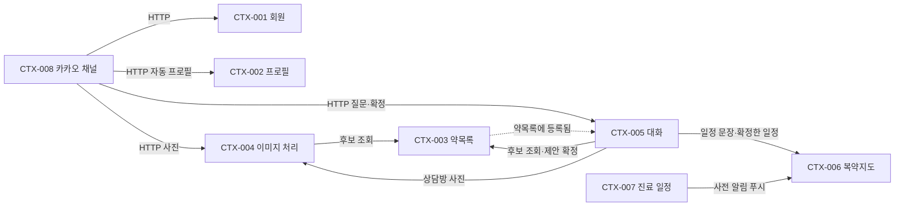

# 필받음 v3 도메인 설계

상태: AI 일괄 초안(one-pass)을 Miro 보드에 올린 뒤 PM이 체크포인트 질문 5개에 "추천대로 진행"으로 답함(2026-11-02, DEC-010~014). 같은 날 DDD 샘플 보드·외부 자료와 비교한 뒤 PM이 "판단한 대로 모두 승인"라고 답해, v3에서 새로 생기거나 바뀌는 컨텍스트(CTX-003·005·007·008)만 Step 8·9를 보강함(DEC-015: 정책·읽기 모델 목록, 애그리거트 규칙, 관계 유형, 팀 함께 보기). H-16은 DEC-016으로 답함. 비교 근거는 docs/research/2026-11-02-ddd-depth에 있음. 범위는 v3 범위 결정 DEC-001~014에 있음. 보드에서 PM이 고친 내용이 생기면 이 문서에 다시 옮김.

컨텍스트 이름·번호는 팀 이벤트 스토밍 보드(2026-10-15, 6개 컨텍스트 = 6개 업무 패키지)에 맞춤. 이 초안의 첫 판(커밋 전)은 컨텍스트를 9개로 나눴으나, 팀 보드가 이미 '약목록 컨텍스트'에 공공데이터 캐시를 함께 두고 있어 8개(기존 6 + 신규 2)로 고침. 첫 판 번호는 어디에도 게시되지 않아 다시 매김.

## 0. PM 목적(원문)과 다시 쓴 말

| 원문(2026-11-02 대화) | 다시 쓴 말 |
| --- | --- |
| "약봉이를 통해 약 등록(사진 혹은 대화) = 기존 약등록과 마찬가지로 공공데이터 연결해서." | 약봉이 대화와 사진으로도 공공데이터에 있는 약을 찾아 약목록에 등록함. 저장은 사용자가 제안을 확인한 뒤에만 함(DEC-001). |
| "카카오봇과 연결 -> 사진+음성으로 약봉이 모든 기능 가능하게" | 카카오톡 약봉이에서도 글·사진·음성으로 질문·등록·일정 확인을 함. 지인만 쓰는 비공식 운영이며 채널 검색은 꺼 둠(DEC-002). |
| "약목록에서 약 삭제(현재 약 하나하나 들어가야함), 금기정보 툴팁, 기다리는 동안 돌아가는 표시 등" | 약목록에서 여러 개를 한 번에 지우고, 금기 표시에 설명을 붙이고, 오래 걸리는 처리에 진행 표시를 둠. |
| "그 10mg을 따로 빼라는거야 … 이름에 10mg라고 써지면 사진으로 검색을 못하는경우가 있더라고" | 약 이름과 함량을 나눠 저장·표시하고, 검색은 함량을 뗀 이름으로 한 뒤 함량을 단위를 맞춰 비교함(DEC-005·006). |
| "시간수정이 어려움 … + 을 넣어서 시간과 분을 증가" / "병원일정도 있으면 … 엄마가 데리고 가는것 처럼 = 구글캘린더 연동" / "알람도 일주일 전. 하루전 등" | 복약 시간을 +/−로 고침. 가족의 진료 일정과 데려가는 사람을 적고, 1주 전·1일 전·당일 알림을 받으며, 구글 캘린더에는 링크·ics로 넣음(DEC-004). |

## 1. 서비스 개요

필받음은 본인과 가족의 약을 사진·이름·대화로 등록하고, 식약처 공공데이터 근거로 복약 일정·알림·AI 상담(약봉이)을 받는 웹 서비스임. v3는 대화 등록, 카카오톡 약봉이의 사진·음성, 목록·입력 사용성, 함량 분리, 진료 일정과 사전 알림을 더함.

| 주체 | 하는 일 |
| --- | --- |
| 회원 | 웹에 로그인해 본인·가족 프로필, 약, 복약 일정, 진료 일정, 상담을 관리함 |
| 카카오 지인 | 웹 로그인 없이 카카오톡 1:1 채팅으로 약봉이와 대화함. 약봉이 전용 계정 아래 자기 프로필 하나로만 식별됨 |
| 운영자(PM) | 카카오 연결을 확인·해제하고 약봉이 전용 계정을 관리함 |
| 정책(시간) | 복약 알림·사전 알림·제안 만료처럼 시각이 되면 실행됨 |

| 외부 시스템 | 주고받는 것 |
| --- | --- |
| 식약처 공공데이터(의약품 허가정보·e약은요·낱알식별·DUR) | 약 후보·공식 정보·금기 정보 |
| OpenAI | 사진 판독, 질문 분류, 답변, 음성 받아쓰기 |
| 카카오톡 봇(게이트웨이 웹소켓·콜백·메시지 전송 API) | 카카오 지인의 메시지 수신과 답장 |
| Web Push 서비스 | 복약 알림·사전 알림 전달 |
| 구글 캘린더 | 사용자가 링크·ics로 직접 일정을 추가함. 필받음은 구글 계정에 접근하지 않음 |
| Qdrant(선택) | 상담 기록 검색 |

## 2. 이벤트 스토밍

- 보드: Event Storming Guide의 팀 보드(2026-10-15)에 v3 추가분 프레임을 '필받음 최종 ERD' 프레임 오른쪽에 둠. 기존 Step 0~7 프레임과 ERD는 고치지 않음.
- 방식: AI 일괄 초안을 보드에 올리고 PM이 보드에서 고침. 체크포인트 질문은 6장 끝과 프레임 아래 상자에 한 번에 모음.
- DEC-015 보강(4.0절 정책·읽기 모델, 애그리거트 규칙, 5장 관계 유형)은 이 문서에 먼저 쓰고, 보드에는 'v3 Step 8-b · 컨텍스트 지도'와 'v3 Step 9 · 바뀌는 컨텍스트 정리표' 프레임 두 장을 v3 추가분 프레임 오른쪽에 더함(2026-11-02 14시 무렵). 8-b는 5장 의존표·관계 유형표를, 9는 4장의 CTX-003·005·007·008 표와 애그리거트 규칙을 옮긴 것임. 보드를 고칠 일이 생기면 이 문서를 먼저 고침.
- 표기: ★는 v3에서 새로 생기는 것, 표기가 없으면 v2에 이미 있는 것임.

### 2.1 이벤트 타임라인

| 흐름 | 이벤트(왼쪽부터 시간 순) |
| --- | --- |
| A. 약 등록 | 사진 판독됨 → 약 후보 찾음(★함량 일치·★함량 다름) / 후보 없음 → ★등록 제안 만들어짐 → ★등록 제안 확정됨 / ★등록 제안 취소됨 / ★등록 제안 만료됨 → 약목록에 등록됨 → 금기 정보 미리 조회됨 |
| B. 약목록 정리 | 약목록 약 변경됨 · 약목록 약 삭제됨 · ★약목록 여러 개 삭제됨 |
| C. 복약 일정 | (★일정 제안 만들어짐 → ★일정 제안 확정됨 / ★일정 제안 취소됨 / ★일정 제안 만료됨 →) 복약 일정 저장됨 → 복약 알림 보내짐 |
| D. 진료 일정 ★ | 진료 일정 등록됨 → 사전 알림 예약됨 → 사전 알림 보내짐 / 사전 알림 실패함 · 진료 일정 변경됨(사전 알림 다시 예약됨) · 진료 일정 삭제됨(사전 알림 취소됨) |
| E. 카카오 ★ | 카카오 지인 처음 들어옴 → 프로필 정보 받음 → 프로필 자동 생성됨 → 카카오 연결됨 → 메시지 묶음 닫힘 → (질문·사진·음성 처리) · 음성 받아쓰기 끝남 / 받아쓰기 실패함 · 카카오 연결 해제됨 |
| F. 상담 | 질문 접수됨 → 답변 만들어짐 / 답변 차단됨 / 답변 실패함 |
| G. 공식 약 정보 | 공식 약 정보 저장됨(★함량 분리 포함) · ★기존 약 함량 채워짐 |

같은 뜻으로 묶은 이름: "약 추가·약 저장" → 약목록에 등록됨, "병원 일정·병원 예약" → 진료 일정, "미리 알림·D-7 알림" → 사전 알림, "용량·mg" → 함량. 원래 이름은 7장 용어집의 '피할 말'에 남김.

### 2.2 이벤트에서 뺀 것과 이유

| 뺀 것 | 이유 | 다룰 곳 |
| --- | --- | --- |
| 약 검색, 목록·상세 조회, 로그인 | 데이터를 바꾸지 않는 읽기·인증임 | 02 PRD·08 화면 |
| 구글 캘린더 링크·ics 내려받기 | 필받음 데이터를 바꾸지 않음. 사용자 캘린더에 사본을 만듦 | 02 PRD·06 API |
| 금기 설명 열기, 시간 +/− 조작, 기다림 표시 | 저장 전 화면 상태임 | 08 화면정의서 |
| 연속 메시지가 들어오는 순간마다 | 묶음이 닫힐 때만 업무 의미가 생김 | 카카오 다리 설계 |

## 3. 바운디드 컨텍스트와 패키지

| 컨텍스트 | 유형 | 애그리거트 | 패키지 | v3 변화 |
| --- | --- | --- | --- | --- |
| CTX-001 회원 | generic | 회원 | `member` | 없음 |
| CTX-002 프로필 | supporting | 프로필 | `profile` | 카카오 자동 프로필이 기존 생성 API를 씀. 관계 값 `OTHER` 추가(DEC-012), 자동 프로필의 임신 여부(DEC-016) |
| CTX-003 약목록 | core | 약목록 약(`my_drug`), 공식 약(`drug`, 공공데이터 캐시·함량 값 포함) | `drug` | ★함량 분리 저장, ★여러 개 삭제, 함량 표시 |
| CTX-004 이미지 처리 | supporting | 사진 식별 결과, 알약 식별 결과 세션 | `image` | ★함량 다른 후보 표시(REG-003 변경) |
| CTX-005 대화 | core | 상담방, 질문·답변, ★등록 제안, ★일정 제안 | `chat` | ★대화 등록 제안·확정, ★대화 일정 제안·확정 |
| CTX-006 복약지도 | core | 복약 일정(약목록 약의 일정 칸), 알림 설정, 푸시 구독, 음성 일정 명령 | `medication` | 시간 입력 방식(화면), 알림 발송을 진료 일정과 함께 씀 |
| CTX-007 진료 일정 ★ | supporting | 진료 일정(사전 알림 규칙 포함) | `medication` 하위 후보(H-07) | 신규 |
| CTX-008 카카오 채널 ★ | supporting | 카카오 연결, 메시지 묶음 | 별도 저장소 `kakao:yakbong/` | 자동 프로필, 사진·음성, 연속 메시지 묶기 |

- CTX-003은 팀 보드대로 공공데이터 캐시(공식 약)와 회원의 약목록을 함께 가짐. 같은 컨텍스트 안에서도 '공식 약'은 식약처 원본 사본, '약목록 약'은 프로필이 먹는 약으로 말을 나눔.
- CTX-003과 CTX-006은 같은 `my_drug` 행을 씀(약 정체와 복약 일정 칸). v2 설계 그대로 두고, 같은 행이라도 '약목록'은 무엇을 먹는지, '복약지도'는 언제 먹는지로 말을 나눔.
- CTX-008은 필받음 서버 밖(카카오 다리 `카톡 다리 저장소`)에 있음. 다리는 답을 지어내지 않고 필받음 API를 부르기만 함(다리 README 원칙).

## 4. 컨텍스트 표

각 행은 API 후보임. ★는 v3 신규.

### 4.0 정책과 읽기 모델 (Step 8-a, DEC-015)

정책은 사건이 생기면 저절로 내는 명령임. 경계를 넘는 정책은 5장의 의존에 나옴. v3에서 새로 생기거나 바뀌는 것과, 그것과 맞물리는 v2 정책만 적음.

| 정책 | 경계 | 근거 |
| --- | --- | --- |
| ★카카오 지인의 프로필 정보를 받으면 프로필 자동 만들기 | CTX-008에서 CTX-002로(HTTP 호출) | V3-KAKAO-002, DEC-016 |
| ★메시지 묶음이 닫히면 필받음에 넘기기(질문·사진 식별·제안 확정·취소) | CTX-008에서 CTX-004·005로(HTTP 호출) | V3-KAKAO-003·004·005 |
| ★음성이 든 묶음이 닫히면 음성 받아쓰기 | CTX-008에서 필받음 서버 받아쓰기 API로(H-02 추천, 자리는 06 API에서 정함) | V3-KAKAO-006 |
| ★질문이 약 등록 요청으로 분류되면 등록 제안 만들기 | 넘지 않음(후보는 CTX-003에 물음) | V3-CHAT-001·002 |
| ★상담에서 사진 식별이 끝나면 등록 제안 만들기 | 넘지 않음(판독은 CTX-004에 물음) | V3-CHAT-006 |
| ★질문이 일정 요청으로 분류되면 일정 제안 만들기 | 넘지 않음(해석은 CTX-006에 물음) | V3-CHAT-007 |
| ★등록 제안이 확정되면 약목록에 등록하기 | CTX-005에서 CTX-003으로(호출, 한 트랜잭션) | V3-CHAT-003 |
| ★일정 제안이 확정되면 복약 일정 저장하기 | CTX-005에서 CTX-006으로(호출) | V3-CHAT-007 |
| ★제안 뒤 30분이 지나면 제안 만료하기 | 넘지 않음 | V3-CHAT-005 |
| ★캐시에 없는 약을 만나면 공식 약 정보 저장하기(함량 분리) | 넘지 않음 | V3-DRUG-001 |
| 약목록에 등록되면 금기 정보 미리 조회하기(v2) | CTX-003에서 CTX-005로(이벤트) | v2 `RegistrationDurPrefetch` |
| ★사전 알림 시각이 되면 사전 알림 보내기 | CTX-007에서 CTX-006의 푸시 경로로(호출) | V3-NOTI-002 |
| 복약 시각이 되면 복약 알림 보내기(v2) | 넘지 않음 | v2 |

읽기 모델은 명령을 내리기 전에 보는 정보임. 07 사이트맵·08 화면정의서의 화면 후보로 씀.

| 읽기 모델 | 보여 주는 것 | 이것을 보고 내는 명령 | 내어 주는 곳 |
| --- | --- | --- | --- |
| ★약 후보 | 기본 이름·함량 원문·함량 상태(일치·다름·확인 불가) | 약목록에 등록, 등록 제안 만들기 | CTX-003 |
| ★약목록(선택 상태) | 고른 약 수, 함께 지워지는 일정·알림 | 약목록 여러 개 삭제 | CTX-003 |
| ★등록 제안 카드 | 항목별 후보·함량·'이미 등록됨', 만료 시각 | 등록 제안 확정·취소 | CTX-005 |
| ★일정 확인 카드 | 대상 약, 지금 → 바뀐 뒤(시각·개수·기간) | 일정 제안 확정·취소 | CTX-005 |
| 프로필 목록 | 진료 받는 사람·동행자 후보 | 진료 일정 등록 | CTX-002 |
| ★진료 일정 상세 | 날짜·시각·병원·동행자·알림 켜짐, 캘린더 링크·ics | 진료 일정 변경·삭제 | CTX-007 |
| ★캘린더(복약·진료) | 같은 날 칸에 복약과 진료를 다른 모양으로 | (보기만. 진료를 누르면 진료 일정 상세) | CTX-006·007 |
| ★시작 안내 | AI 답변·운영자 열람·카톡 알림 없음·삭제 요청 방법 | 프로필 정보 보내기 | CTX-008 |
| ★연결 목록 | 연결된 지인과 그 프로필, 해제됐지만 기록 삭제가 남은 지인 | 연결 해제 | CTX-008 |

### CTX-001 회원

목적: 회원 가입·로그인·약관 동의.

| 주체 | 읽기 모델 | 명령 | 애그리거트 | 이벤트 |
| --- | --- | --- | --- | --- |
| 회원, 카카오 다리(약봉이 계정) | 약관 목록 | 로그인 | 회원 | (인증은 이벤트 아님) |

- 외부 시스템: 없음 · 링크: 모든 컨텍스트가 인증 결과를 씀 · 핫스팟: 없음

### CTX-002 프로필

목적: 한 회원 아래 본인·가족(카카오 지인 포함) 프로필을 둠.

| 주체 | 읽기 모델 | 명령 | 애그리거트 | 이벤트 |
| --- | --- | --- | --- | --- |
| 회원 | 프로필 목록 | 프로필 만들기 | 프로필 | 프로필 만들어짐 |
| ★정책: 카카오 지인의 프로필 정보를 받았을 때(CTX-008) | — | 프로필 만들기 | 프로필 | 프로필 자동 생성됨 |
| 회원 | 프로필 상세 | 프로필 삭제 | 프로필 | 프로필 삭제됨(마지막 프로필은 막음) |

- 애그리거트 규칙: 프로필은 한 회원 아래에만 있고 마지막 프로필은 지울 수 없음(v2). ★자동 프로필은 관계 `OTHER`이고, 호칭·출생연도·성별을 받은 뒤에만 만들며 임의 값으로 만들지 않음. 임신 여부는 남성이면 '아니오', 여성·모름이면 한 번 물은 답으로 둠(DEC-011·016).
- 외부 시스템: 없음 · 링크: CTX-008이 HTTP로 부름 · 핫스팟: H-03, H-04, H-05, H-16(모두 답함)

### CTX-003 약목록

목적: 공공데이터 의약품 정보를 캐시해 이름과 함량을 나눠 두고, 프로필별로 먹는 약을 등록·변경·삭제함.

| 주체 | 읽기 모델 | 명령 | 애그리거트 | 이벤트 |
| --- | --- | --- | --- | --- |
| 정책: 검색·식별·제안에서 캐시에 없는 약을 만났을 때 | 허가정보 응답 | 공식 약 정보 저장 | 공식 약 | 공식 약 정보 저장됨(★함량 분리) |
| ★운영자(한 번 실행) | 기존 `drug` 행 | 기존 약 함량 채우기 | 공식 약 | 기존 약 함량 채워짐 |
| 회원, 정책: 등록 제안 확정됨(CTX-005) | 약 후보(함량 포함) | 약목록에 등록 | 약목록 약 | 약목록에 등록됨 |
| 회원 | 약 상세 | 약목록 약 변경 | 약목록 약 | 약목록 약 변경됨 |
| 회원 | 약 상세 | 약목록 약 삭제 | 약목록 약 | 약목록 약 삭제됨 |
| ★회원 | 약목록(선택 상태) | 약목록 여러 개 삭제 | 약목록 약 | 약목록 여러 개 삭제됨(한 트랜잭션 후보) |

- 애그리거트 규칙: ★공식 약의 함량 원문은 품목명에서 뗀 글자 그대로 두고, 값·단위는 단일 성분의 질량 단위만 μg로 정규화함. 정규화가 안 돼도 저장은 막지 않음(V3-DRUG-001, H-06). ★여러 개 삭제는 고른 1~50개가 모두 지워지거나 하나도 안 지워지며, 약과 함께 그 복약 일정·알림이 지워짐(V3-DRUG-003).
- 외부 시스템: 식약처 의약품 허가정보·e약은요·낱알식별
- 링크: CTX-004·005가 후보 조회로 부름. 등록되면 CTX-005가 금기 정보를 미리 조회함(v2 `RegistrationDurPrefetch`)
- 핫스팟: H-06(복합제·단위 표기), H-08(삭제 되돌리기)

### CTX-004 이미지 처리

목적: 처방전·약봉투·알약 사진을 판독해 공식 약 후보를 찾음.

| 주체 | 읽기 모델 | 명령 | 애그리거트 | 이벤트 |
| --- | --- | --- | --- | --- |
| 회원, ★카카오 다리(CTX-008) | — | 처방전 사진 식별 | 사진 식별 결과 | 사진 판독됨, 약 후보 찾음(★함량 일치·★함량 다름) / 후보 없음 |
| 회원 | — | 알약 사진 식별 | 알약 식별 결과 세션 | 알약 후보 찾음 / 후보 없음 |

- 외부 시스템: OpenAI(판독), 공공데이터(후보)
- 링크: CTX-003 후보 조회(기본 이름·함량), CTX-005가 결과로 등록 제안을 만듦
- 핫스팟: H-01, H-06

### CTX-005 대화

목적: 등록한 약과 공식 근거로 질문에 답하고(약봉이), ★대화 속 등록 요청을 확인 가능한 제안으로 바꿈.

| 주체 | 읽기 모델 | 명령 | 애그리거트 | 이벤트 |
| --- | --- | --- | --- | --- |
| 회원, 카카오 다리 | 상담 기록, 약목록 | 질문 보내기 | 질문·답변 | 질문 접수됨 → 답변 만들어짐 / 답변 차단됨 / 답변 실패함 |
| ★정책: 질문이 약 등록 요청으로 분류됐을 때 | 약 후보(CTX-003) | 등록 제안 만들기 | 등록 제안 | 등록 제안 만들어짐 |
| ★정책: 상담에서 사진 식별이 끝났을 때 | 사진 식별 결과(CTX-004) | 등록 제안 만들기 | 등록 제안 | 등록 제안 만들어짐 |
| ★회원, 카카오 다리 | 등록 제안 카드 | 등록 제안 확정 | 등록 제안 | 등록 제안 확정됨 |
| ★회원, 카카오 다리 | 등록 제안 카드 | 등록 제안 취소 | 등록 제안 | 등록 제안 취소됨 |
| ★정책: 질문이 일정 요청으로 분류됐을 때 | 약목록·약 일정(CTX-006 해석) | 일정 제안 만들기 | 일정 제안 | 일정 제안 만들어짐 |
| ★회원, 카카오 다리 | 일정 확인 카드 | 일정 제안 확정 | 일정 제안 | 일정 제안 확정됨 → (CTX-006 복약 일정 저장됨) |
| ★회원, 카카오 다리 | 일정 확인 카드 | 일정 제안 취소 | 일정 제안 | 일정 제안 취소됨 |
| ★정책: 제안 뒤 30분이 지났을 때 | — | 제안 만료 | 등록 제안, 일정 제안 | 등록 제안 만료됨, 일정 제안 만료됨 |

- 애그리거트 규칙: ★등록 제안·일정 제안의 상태는 대기 → 확정·취소·만료 한 방향으로만 감. 확정은 대기이고 만료 전(만든 뒤 30분)일 때 한 번만 되며, 동시에 두 번 확정해도 하나만 성공함. 확정과 저장은 한 트랜잭션임. 등록 제안은 항목 10개까지이고 이미 등록된 품목은 고를 수 없음. 일정 제안은 확정 사이에 일정이 바뀌면 확정하지 않음(V3-CHAT-002~005·007). 두 제안을 한 테이블에 둘지는 05 ERD에서 정함(H-10).
- 외부 시스템: OpenAI(분류·답변), DUR
- 링크: 확정 시 CTX-003 약목록 등록을 부름. 일정 요청은 CTX-006의 단문 일정 해석을 '해석만' 하고, 확인 카드 확정 뒤 저장함(기존 `POST /api/schedule-voice-commands`는 확인 없이 저장하므로 대화 경로에서는 그대로 쓰지 않음)
- 핫스팟: H-09, H-10

### CTX-006 복약지도

목적: 약목록 약의 복약 시간·기간을 정하고 알림을 보냄. 알림 발송(푸시)은 진료 일정과 함께 씀.

| 주체 | 읽기 모델 | 명령 | 애그리거트 | 이벤트 |
| --- | --- | --- | --- | --- |
| 회원, 음성 일정 명령, ★정책: 일정 제안 확정됨(CTX-005) | 약 일정 | 복약 일정 저장 | 복약 일정 | 복약 일정 저장됨 |
| 정책: 복약 시각이 됐을 때 | 알림 설정·푸시 구독 | 복약 알림 보내기 | 알림 설정 | 복약 알림 보내짐 |
| 회원 | 알림 설정 | 알림 설정 바꾸기·푸시 구독 | 알림 설정, 푸시 구독 | 알림 설정 바뀜, 푸시 구독됨 |

- 외부 시스템: Web Push 서비스
- 링크: CTX-007이 사전 알림 발송에 푸시 경로를 씀, CTX-005 일정 제안이 단문 일정 해석을 씀
- 핫스팟: 없음(시간 +/− 입력은 화면 문제라 08에서 다룸)

### CTX-007 진료 일정 ★

목적: 가족의 병원 진료 일정과 데려가는 사람을 적고, 미리 알림을 받고, 구글 캘린더에 옮길 링크를 줌.

| 주체 | 읽기 모델 | 명령 | 애그리거트 | 이벤트 |
| --- | --- | --- | --- | --- |
| 회원 | 프로필 목록(진료 받는 사람·동행자) | 진료 일정 등록 | 진료 일정 | 진료 일정 등록됨, 사전 알림 예약됨 |
| 회원 | 진료 일정 상세 | 진료 일정 변경 | 진료 일정 | 진료 일정 변경됨, 사전 알림 다시 예약됨 |
| 회원 | 진료 일정 상세 | 진료 일정 삭제 | 진료 일정 | 진료 일정 삭제됨, 사전 알림 취소됨 |
| 정책: 사전 알림 시각이 됐을 때(스케줄러) | 알림 설정·푸시 구독(CTX-006) | 사전 알림 보내기 | 진료 일정 | 사전 알림 보내짐 / 사전 알림 실패함 |

- 애그리거트 규칙: ★진료 받는 사람과 동행자 프로필은 같은 회원 것이고, 동행자는 프로필 하나·직접 적은 이름 하나·없음 가운데 하나임. 사전 알림은 진료 일정·알림 종류·진료 시각마다 한 번만 보냄(선점). 이미 보낸 알림은 다시 보내지 않음. 날짜·시각이 바뀌면 옛 시각의 보내지 않은 알림은 취소하고 새 시각으로 다시 계산하며, 새 시각의 알림은 새 알림으로 봄. 지난 시각은 예약하지 않음(V3-APPT-001·002, V3-NOTI-001·002).
- 외부 시스템: Web Push, 구글 캘린더(링크·ics만)
- 링크: CTX-006 푸시 경로를 부름
- 핫스팟: H-07, H-11, H-12

### CTX-008 카카오 채널 ★(다리 저장소)

목적: 카카오 지인을 자기 프로필에 연결하고, 글·사진·음성을 묶어 필받음에 넘기고, 답을 카카오 형식으로 돌려줌.

| 주체 | 읽기 모델 | 명령 | 애그리거트 | 이벤트 |
| --- | --- | --- | --- | --- |
| 카카오 지인 | — | 말 걸기(첫 메시지·입장) | 카카오 연결 | 카카오 지인 처음 들어옴 |
| 카카오 지인 | 시작 안내 | 프로필 정보 보내기(호칭·출생연도·성별) | 카카오 연결 | 프로필 정보 받음 |
| 정책: 프로필 정보 받음 | — | 프로필 자동 만들기(CTX-002 호출) | 카카오 연결 | 카카오 연결됨 |
| 운영자 | 연결 목록(해제 기록 포함) | 연결 해제 | 카카오 연결 | 카카오 연결 해제됨 |
| 카카오 지인 | — | 메시지 보내기(글·사진·음성) | 메시지 묶음 | 메시지 묶음 닫힘(조용한 시간이 지남) |
| 정책: 음성이 든 묶음이 닫혔을 때 | — | 음성 받아쓰기 | 메시지 묶음 | 받아쓰기 끝남 / 받아쓰기 실패함 |
| 정책: 메시지 묶음 닫힘 | 카카오 연결 | 필받음에 넘기기(질문·사진 식별·제안 확정) | — | (CTX-004·005의 이벤트) |

- 지인은 연결된 자기 프로필과 자기 제안만 씀. 해제하면 다음 말은 시작 안내부터 다시 함. 해제 기록은 기록 삭제가 끝날 때까지 옛 프로필 ID를 남겨, 해제 뒤의 삭제 요청과 실패한 삭제의 재시도를 받음. 메시지 묶음은 같은 지인 것만 모으고 서버 호출을 시작하면 닫히며(상한 10개·1,000자, 받아쓴 음성 포함. 기존 질문 API 상한), 묶음 하나에 답 하나임(V3-KAKAO-002·003·005·010, H-13).
- 외부 시스템: 카카오톡 봇 게이트웨이·콜백·메시지 전송 API, OpenAI(받아쓰기 위치는 H-02)
- 링크: CTX-001·002·004·005를 HTTP로 부름(다리 → 127.0.0.1의 필받음 서버)
- 핫스팟: H-01, H-02, H-03, H-04, H-13, H-14

## 5. 컨텍스트 사이 의존

| From | To | 종류 | 이유 | 데이터 |
| --- | --- | --- | --- | --- |
| CTX-004 | CTX-003 | 호출(동기) | 판독한 이름으로 후보 찾기 | 함량을 뗀 이름, 함량 값·단위 |
| CTX-005 | CTX-003 | 호출(동기) | 등록 제안 후보 찾기 | 약 이름, 함량 |
| CTX-005 | CTX-004 | 호출(동기) | 상담방 사진 판독(DEC-015 보강에서 빠진 것을 찾음) | 사진 파일, 프로필 |
| CTX-005 | CTX-003 | 호출(동기) | 제안 확정 시 약목록 등록 | 프로필, 품목기준코드, 등록 방법(대화), 일정 칸 |
| CTX-005 | CTX-006 | 호출(동기) | 일정 요청을 해석하고, 확정 뒤 저장 | 프로필, 문장, 확정한 일정 값 |
| CTX-003 | CTX-005 | 이벤트(비동기) | 등록되면 금기 정보 미리 조회 | 프로필, 품목기준코드 |
| CTX-007 | CTX-006 | 호출(동기) | 사전 알림을 푸시로 보냄 | 회원, 알림 문구, 일정 링크 |
| CTX-008 | CTX-001 | 호출(HTTP) | 약봉이 계정 로그인 | 계정(비밀값은 다리 서버 `.env`에만) |
| CTX-008 | CTX-002 | 호출(HTTP) | 지인 프로필 자동 만들기 | 호칭, 출생연도, 성별, 임신 여부(DEC-016), 관계 |
| CTX-008 | CTX-004 | 호출(HTTP) | 카톡 사진 식별 | 사진 파일, 프로필 |
| CTX-008 | CTX-005 | 호출(HTTP) | 질문·제안 확정·취소 | 상담방, 묶은 글, 제안 ID |

동기 호출의 순환은 없음. CTX-005 → CTX-003은 호출, 반대 방향은 비동기 이벤트임.

경계마다의 관계 유형(Step 8-b 보강, DEC-015). 번역층(ACL)은 바깥 모양을 안쪽 말로 바꾸는 곳이라, 그 코드가 어디에 사는지를 정함.

| 경계 | 관계 유형 | 뜻 |
| --- | --- | --- |
| CTX-008 → CTX-001·002·004·005 | 번역층(ACL, 다리) | 다리가 카카오 형식을 기존 필받음 API 호출로 바꿈. 필받음 서버는 카카오 모양을 모름 |
| CTX-003·004 → 식약처 공공데이터 | 번역층(ACL) | 허가정보 응답을 공식 약 캐시·함량 값으로 바꿔 둠. 공공데이터 응답 모양이 바뀌어도 약목록은 그대로임 |
| CTX-004·005 → OpenAI | 번역층(ACL) | 판독·분류 결과를 후보 이름·의도 값으로만 받음. 사진·글 속 지시는 따르지 않음(V3-REQ-62) |
| CTX-005 → CTX-003·006 | 순응(conformist) | 대화는 기존 items 저장 계약과 일정 저장 규칙을 바꾸지 않고 그대로 씀 |
| CTX-007 → CTX-006 | 고객-공급자 | 진료 일정이 복약지도의 푸시 경로를 씀. 같은 `medication` 패키지 아래에 있음(DEC-010) |
| CTX-007 → 구글 캘린더 | 공표된 언어(iCalendar) | 계정 연동 없이 링크·ics 표준 형식으로만 넘김(DEC-004) |

## 6. 핫스팟

| ID | 핫스팟 | 컨텍스트 | 상태 | 답 또는 다음 행동 |
| --- | --- | --- | --- | --- |
| H-01 | 카카오톡 봇이 사진·음성 메시지를 받는지, 파일을 어떻게 받는지 | CTX-008·004 | 사진은 답함, 음성은 열림 | 관찰: PM의 다른 카톡 봇 코드는 사진이 `content`에 만료되는 카카오 CDN 주소 하나로 온다고 적고 그대로 처리함. 실제 카톡 음성 메시지 형식은 미확인이며, 11/4 뒤 실제 음성 1건으로 `content` 모양만 확인함(주소·내용은 로그에 남기지 않음) |
| H-02 | 음성 받아쓰기를 어디서 하나(필받음 서버 API vs 다리가 직접) | CTX-008 | 열림 | 추천: 필받음 서버에 받아쓰기 API를 둠. 키를 한 곳에 두고 로그 규칙을 함께 씀 |
| H-03 | 자동 프로필 필수값: 이름 10자·관계·출생연도·성별이 필수이고, 출생연도·성별은 DUR 연령·임부 판단에 쓰임 | CTX-002·008 | 답함 | DEC-011: 첫 안내에서 호칭·출생연도·성별(모름 가능)을 받은 뒤 만듦. 임의 값으로 만들지 않음 |
| H-04 | 약봉이 계정 하나에 지인 프로필이 쌓여 운영자가 웹에서 모두 볼 수 있음(건강정보) | CTX-002·008 | 답함 | DEC-011: 첫 안내에 AI 답변·운영자 열람 가능·삭제 요청 방법을 알림. 지인끼리는 서로 보이지 않음(연결된 프로필만 씀) |
| H-05 | 관계 값에 지인이 없음(`SELF·MOTHER·FATHER·DAUGHTER·SON·GRANDMA·GRANDPA·SPOUSE`) | CTX-002 | 답함 | DEC-012: `OTHER`(지인·기타)를 더함. 화면 이름표도 함께 더함 |
| H-06 | 함량 표기 변형: 복합제(`500/125mg`), 단위(밀리그램·mg·마이크로그램·g·%·IU), 괄호 성분명 | CTX-003·004 | 열림 | 추천: 원문 함량 글자는 그대로 두고, 값·단위는 단일 성분만 정규화함. 복합제는 원문 비교로 처리 |
| H-07 | 진료 일정을 별도 컨텍스트로 둘지와 패키지 위치 | CTX-007 | 답함 | DEC-010: 업무 말(진료·동행자·사전 알림)이 복약과 달라 별도 컨텍스트로 두고, 코드는 `medication` 하위 패키지에 둠. 스케줄러·푸시를 함께 쓰고 6개 업무 패키지 규칙을 지킴 |
| H-08 | 여러 개 삭제의 되돌리기 | CTX-003 | 열림 | 추천: 1차는 삭제 전 확인 창(고른 수·함께 지워지는 일정·알림)만 둠. 화면에서 요청을 늦추는 되돌리기는 창을 닫으면 삭제가 빠지는 등 경계가 많아 뒤로 미룸. 서버는 한 번에 지우는 API만 둠 |
| H-09 | 질문(“타이레놀 먹어도 돼?”)과 등록 요청(“타이레놀 등록해 줘”)을 잘못 가르는 경우 | CTX-005 | 답함 | 제안 카드 확인 뒤에만 저장함(DEC-001). 잘못 갈라도 저장되지 않음 |
| H-10 | 등록 제안을 상담 메시지 JSON에 둘지 별도 테이블에 둘지 | CTX-005 | 열림 | 추천: 별도 테이블. 만료·확정 상태와 중복 확정 방지를 DB 제약으로 지킴 |
| H-11 | 동행자를 어떻게 적나(같은 회원의 다른 프로필 vs 직접 입력) | CTX-007 | 열림 | 추천: 프로필 선택과 직접 입력을 둘 다 허용 |
| H-12 | 구글 캘린더 링크·ics는 사본이라 필받음에서 일정을 바꿔도 따라가지 않음 | CTX-007 | 답함 | DEC-004에서 ① 링크·ics를 먼저 하기로 함. 화면에 '바꾼 일정은 다시 추가' 안내를 둠 |
| H-13 | 연속 메시지를 묶어 답할 때 어느 콜백 토큰으로 답하나, 답하지 않은 이벤트의 영향 | CTX-008 | 열림 | 문서에 규칙 없음(Aside 2026-11-02). 추천: 묶음의 마지막 토큰으로 답하고 나머지는 쓰지 않음. 실제 동작은 시험으로 확인 |
| H-14 | 카카오톡 봇 API의 운영 중 사용 가능 여부 | CTX-008 | 열림 | 11/4 결과 뒤 앱 상태를 확인하고 3차를 시작함 |
| H-15 | 카카오 지인에게 복약·사전 알림을 카톡으로 보낼지(메시지 전송 API) | CTX-008·006·007 | 답함 | DEC-013: v3 범위 밖. 카카오 지인에게는 카톡 알림이 없다는 점을 첫 안내에 적음. 관찰로 남김: 다른 카톡 봇 코드가 같은 API로 1:1 친구에게 먼저 말을 거는 구현이 있음 |
| H-16 | 자동 프로필의 임신 여부: 프로필 생성에서 `profilePregnant`가 필수(boolean)이고 임부금기 판단에 쓰임. 출생연도도 필수라 '모름'을 받을 수 없음(성별만 `UNKNOWN` 가능). 코드 확인 2026-11-02 | CTX-002·008 | 답함 | DEC-016: 성별이 남성이면 '아니오'로 두고, 여성·모름이면 빠른 답장(예·아니오)으로 한 번 물음 |

### PM 확인 결과(체크포인트 1~3 묶음)

PM 답: "추천대로 진행"(2026-11-02 12시경, Claude Code 데스크톱 세션). 아래 다섯 질문 모두 추천대로 정함 → Notion DEC-010~014.

1. 컨텍스트 8개와 경계(3장): 팀 보드 6개를 그대로 두고 진료 일정·카카오 채널 2개를 더함. 진료 일정은 별도 컨텍스트로 두되 코드는 `medication` 아래에 둠(H-07). → DEC-010
2. 카카오 자동 프로필 첫 안내에서 호칭·출생연도·성별을 묻고, 운영자가 볼 수 있다는 점을 알림(H-03·H-04): 둘 다 함. → DEC-011
3. 관계 값 `OTHER` 추가(H-05): 추가함. 기존 화면의 관계 선택에도 '지인·기타'가 보이게 됨. → DEC-012
4. 카톡 알림 보내기(H-15): v3 범위 밖. → DEC-013
5. 피드백 C("알람도 일주일 전. 하루전 등")는 진료 일정 사전 알림으로 읽음. 복약 알림은 바꾸지 않음. → DEC-014

나머지 핫스팟(H-02·06·08·10·11·13)은 기술 세부라 추천대로 진행하고 기록함.

같은 날 13시 30분 무렵 PM이 DDD 샘플 보드·외부 자료 비교를 본 뒤 "판단한 대로 모두 승인"라고 답함 → DEC-015(바뀌는 컨텍스트만 Step 8·9 보강, 팀 보드 프레임 두 장, 팀 함께 보기), DEC-016(H-16).

## 7. 용어집

필받음 v2 용어 정의집의 용어(DUR, Live, Web Push 등)는 그대로 씀. 아래는 v3에서 새로 쓰거나 뜻을 좁힌 말임.

| ID | 용어 | 정의 | 컨텍스트 | 코드 이름 | 피할 말 |
| --- | --- | --- | --- | --- | --- |
| TERM-001 | 함량 | 한 제형 단위에 든 성분 양. 원문 글자(`10mg`)와 정규화한 값·단위(10, mg)로 둠 | CTX-003 | `strength` | 용량(복용량과 헷갈림), mg |
| TERM-002 | 기본 이름 | 공식 제품명에서 함량·괄호 성분명을 뗀 이름. 검색에 씀 | CTX-003 | `baseName` | 짧은 이름 |
| TERM-003 | 1회 복용량 | 한 번에 먹는 개수(정·캡슐). 함량과 다름 | CTX-003 | `dosePerTime` | 용량 |
| TERM-004 | 함량 다름 | 후보의 기본 이름은 같고 함량이 판독값과 다른 상태. 보여 주되 자동 선택하지 않음 | CTX-004 | `STRENGTH_MISMATCH` | 불일치 후보 |
| TERM-005 | 등록 제안 | 대화·사진에서 만든 '이 약을 등록할까요' 카드. 확정 전에는 약목록에 없음 | CTX-005 | `RegistrationProposal` | 임시 등록, 가등록 |
| TERM-006 | 제안 확정 | 사용자가 제안 카드에서 고른 항목만 약목록에 저장하는 행동 | CTX-005 | `confirm` | 승인(PM 승인과 헷갈림) |
| TERM-007 | 진료 일정 | 특정 프로필이 병원에서 진료받는 날짜·시각·장소 | CTX-007 | `Appointment` | 병원 일정, 병원 예약 |
| TERM-008 | 동행자 | 진료에 데려가거나 함께 가는 사람. 같은 회원의 프로필이거나 직접 적은 이름 | CTX-007 | `companion` | 보호자(법적 의미와 헷갈림) |
| TERM-009 | 사전 알림 | 진료 일정 전에 보내는 알림. 1주 전·1일 전·당일 중 고름 | CTX-007 | `advanceReminder` | 미리 알림, D-7 알림 |
| TERM-010 | 복약 알림 | 복약 시각에 보내는 알림(v2). 사전 알림과 구분함 | CTX-006 | `MedicationReminder` | 알람 |
| TERM-011 | 캘린더 링크 | 사용자가 눌러 자기 구글 캘린더에 진료 일정 사본을 넣는 링크. ics 파일도 같은 뜻 | CTX-007 | `calendarLink` | 캘린더 연동(양방향으로 오해) |
| TERM-012 | 카카오 지인 | 카카오톡 1:1로 약봉이를 쓰는 사람. 웹 로그인이 없음 | CTX-008 | - | 카카오 회원, 사용자 |
| TERM-013 | 카카오 연결 | - | CTX-008 | `links` | 카카오 로그인 |
| TERM-014 | 자동 프로필 | 카카오 지인이 보낸 호칭·출생연도·성별로 약봉이 계정 아래 만드는 프로필 | CTX-002·008 | — | 임시 프로필 |
| TERM-015 | 메시지 묶음 | 같은 지인이 짧은 간격으로 보낸 글·사진·음성을 한 턴으로 모은 것 | CTX-008 | `batch` | 연속 메시지 |
| TERM-016 | 여러 개 삭제 | 약목록에서 고른 약을 한 번에 지우는 것 | CTX-003 | `bulk delete` | 일괄 삭제(같은 뜻이나 화면 말은 '여러 개 삭제') |
| TERM-017 | 약목록 약 | 프로필이 먹는 약 한 건(`my_drug` 행). 팀 보드의 '약목록'과 같은 말 | CTX-003 | `MyDrug` | 내 약(첫 판에서 쓴 말) |
| TERM-018 | 공식 약 | 식약처 공공데이터를 캐시한 약 정보(`drug` 행). 함량 값을 가짐 | CTX-003 | `Drug` | 공공 약, 원본 약 |
| TERM-019 | 일정 제안 | 대화·카톡의 일정 요청을 해석해 '지금 → 바뀐 뒤'로 보여 주는 확인 카드. 확정 전에는 복약 일정이 그대로임. 상태 규칙은 등록 제안과 같음 | CTX-005 | `ScheduleProposal`(후보) | 일정 자동 변경, 음성 일정 명령(확인 없이 저장하는 v2 명령) |

## 8. 팀 함께 보기 (DEC-015)

이 문서와 보드는 AI 초안에 PM이 답한 것이라, 구현할 팀원과 한 번 함께 봄. 30~40분, Example Mapping 방식(규칙 카드 하나에 예시 카드 두세 장, 모르는 것은 질문 카드)으로 함. 보는 곳은 팀 보드의 Step 8-b·9 프레임과 이 문서 4·5장임.

| 순서 | 볼 것 | 규칙 카드 | 예시 카드(명세 수용 기준) |
| --- | --- | --- | --- |
| 1 | 등록 제안 | 대기 → 확정·취소·만료 한 방향, 한 번만 확정 | '모두 등록'을 두 번 누르면 한 번만 저장(V3-KAKAO-005). 31분 뒤 확정하면 409(V3-CHAT-005) |
| 2 | 일정 제안 | 확정 전에는 일정이 그대로임 | "아침 8시 한 알로 바꿔 줘"는 카드만 뜨고, 확정 뒤 08:00·1정(V3-CHAT-007) |
| 3 | 사전 알림 | 진료 일정·알림 종류·진료 시각마다 한 번 | 서버 두 개가 돌아도 한 번만 받음(V3-NOTI-002). 1일 전 알림 뒤 진료를 미루면 새 시각의 1일 전 알림이 한 번 옴(V3-APPT-002). 이미 지난 시각은 예약하지 않음(V3-APPT-001) |
| 4 | 카카오 연결 | - | 해제 뒤 다시 말을 걸면 시작 안내부터(V3-KAKAO-010) |
| 5 | 함량 | 단일 성분 질량 단위만 값으로 | '알프람정 10mg'은 10000μg, '500/125mg'은 원문만(V3-DRUG-001) |

- 결과 처리: 바뀐 규칙은 이 문서를 먼저 고치고 보드에 옮김(`truth: source`). 답이 없는 질문 카드는 6장 핫스팟으로 남김.
- 모임 일정은 PM이 팀과 정함. 끝나면 참석자와 바뀐 것을 이 절에 적음.
