# 필받음 v3 사용자 흐름

- 상태: 초안(2026-11-02). 입력은 [v3 요구사항](../02-prd/requirements-v3.md) V3-REQ-33~78, [도메인 설계](../01-domain/domain.md) CTX-001~008·TERM-001~018, 결정 DEC-001~014.
- 기존 FL-01~14·V2-FL-15~16은 User Flow Map이 원본이며 여기서 고치지 않음. v3가 바꾸는 기존 흐름은 끝의 '바뀌는 기존 흐름'에 적음.
- 표기: 단계 아래 `R33`은 V3-REQ-33을 줄인 것임. 화면 ID(SCR)는 07 사이트맵 뒤에 붙임.
- Notion 옮김: 흐름마다 아래 Mermaid 코드를 바꾸지 않고 그대로 붙임(다이어그램 먼저, 상세 DB는 보조).

| ID | 흐름 | 차수 | 컨텍스트 | 주요 요구사항 |
| --- | --- | --- | --- | --- |
| V3-FL-17 | 약목록에서 여러 개 삭제 | 1차 | CTX-003 | V3-REQ-39·40 |
| V3-FL-18 | 함량을 나눠 약 찾기·등록 | 1차 | CTX-003·004 | V3-REQ-33~37 |
| V3-FL-19 | 복약 시각을 +/−·숫자로 입력 | 1차 | CTX-006 | V3-REQ-41·42 |
| V3-FL-20 | 오래 걸리는 처리 기다리기 | 1차 | 공통 | V3-REQ-43 |
| V3-FL-21 | 금기 표시 설명 보기 | 1차 | CTX-005 | V3-REQ-44 |
| V3-FL-22 | 웹 약봉이 대화·사진으로 약 등록 | 2차 | CTX-005·003·004 | V3-REQ-45~51 |
| V3-FL-23 | 웹 약봉이 대화로 복약 일정 저장 | 2차 | CTX-005·006 | V3-REQ-52 |
| V3-FL-24 | 카카오 지인 첫 연결 | 3차 | CTX-008·002 | V3-REQ-53~55·78 |
| V3-FL-25 | 카카오 메시지 묶음 처리 | 3차 | CTX-008·004·005 | V3-REQ-56·57·59~65 |
| V3-FL-26 | 카카오에서 등록 제안 확정 | 3차 | CTX-008·005 | V3-REQ-58·48~51 |
| V3-FL-27 | 진료 일정 등록·변경·삭제 | 4차 | CTX-007 | V3-REQ-66~68·71·72·77 |
| V3-FL-28 | 진료 사전 알림 받기 | 4차 | CTX-007·006 | V3-REQ-69·70·72·73 |
| V3-FL-29 | 진료 일정을 구글 캘린더로 옮기기 | 4차 | CTX-007 | V3-REQ-74~76 |

## V3-FL-17 약목록에서 여러 개 삭제

목적: 약을 하나씩 열지 않고 약목록에서 골라 한 번에 지움.

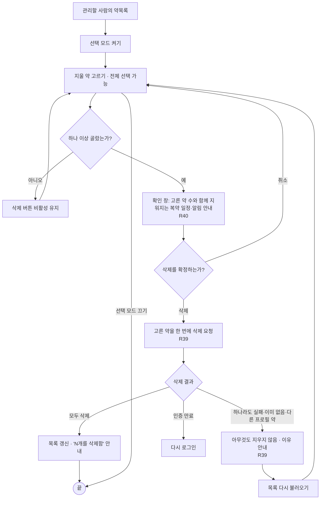

## V3-FL-18 함량을 나눠 약 찾기·등록

목적: 이름에 `10mg` 같은 함량이 붙어 있어도 약을 찾고, 함량이 다른 후보를 구분해 고름.

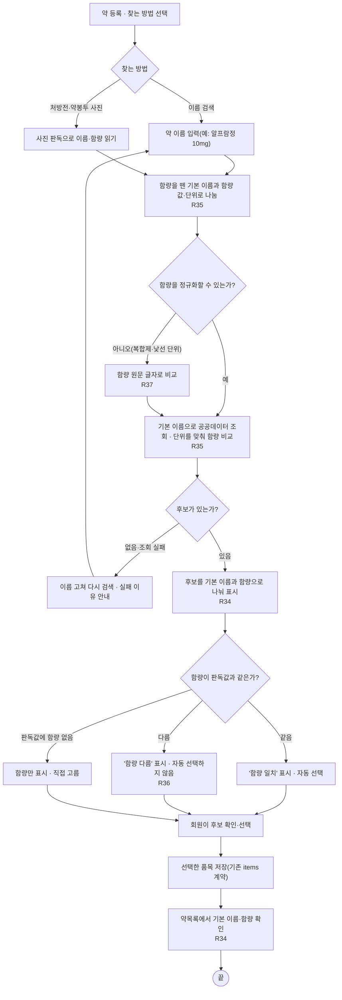

- 공식 약 정보를 처음 캐시할 때 함량을 나눠 저장함(R33). 이미 캐시된 약은 운영자가 한 번 채움(R38, 흐름 없음, 기능 명세에서 다룸).

## V3-FL-19 복약 시각을 +/−·숫자로 입력

목적: 시간 칸에서 `:`를 찾지 않고 시각을 고침.

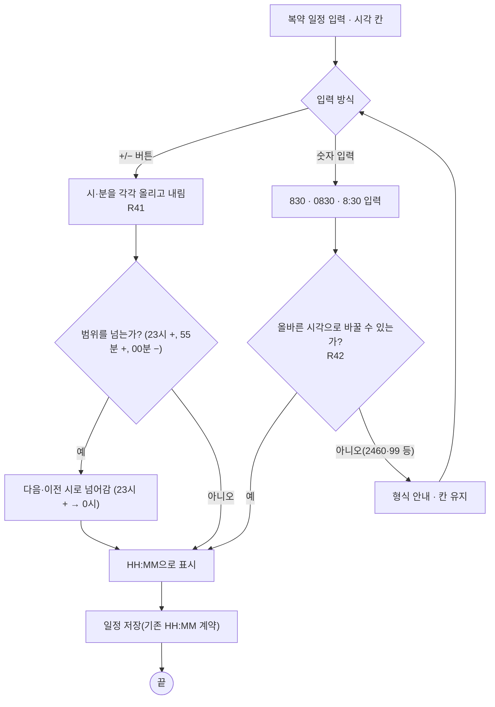

## V3-FL-20 오래 걸리는 처리 기다리기

목적: 사진 판독·검색·답변처럼 오래 걸리는 처리 중에 멈춘 것이 아님을 알림.

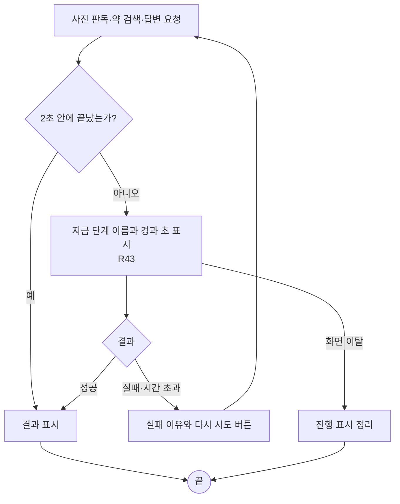

## V3-FL-21 금기 표시 설명 보기

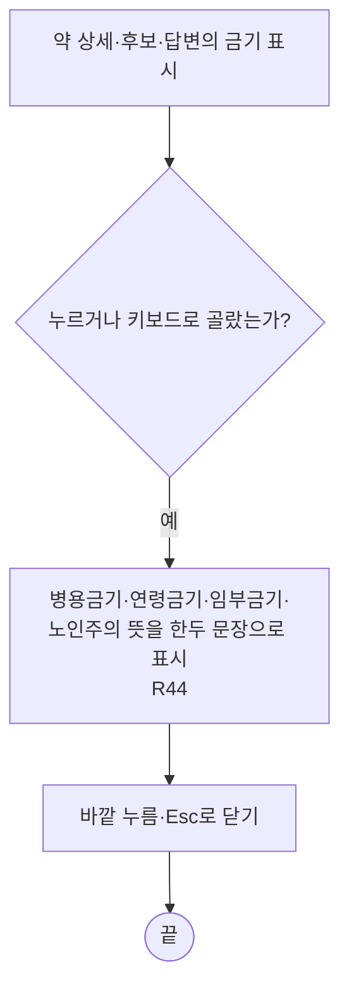

## V3-FL-22 웹 약봉이 대화·사진으로 약 등록

목적: 상담 화면에서 말하거나 사진을 보내 약을 등록함. 저장은 제안 카드 확정 뒤에만 함(DEC-001).

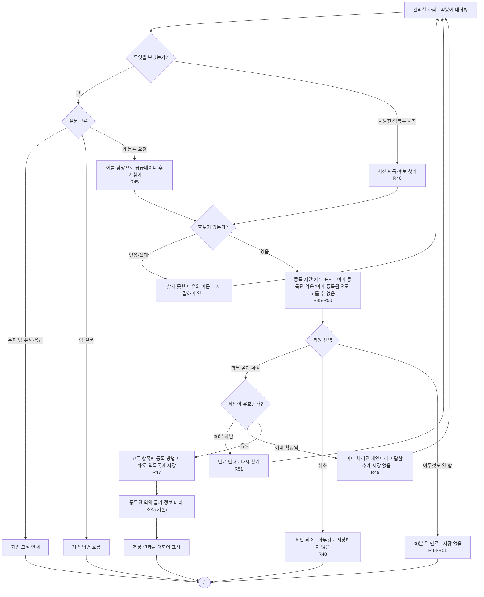

## V3-FL-23 웹 약봉이 대화로 복약 일정 저장

목적: "아침 8시에 한 알로 바꿔 줘" 같은 말로 일정을 바꾸되, 확인 카드를 거쳐 저장함. 기존 화면의 음성 명령(확인 없이 저장)은 바꾸지 않음.

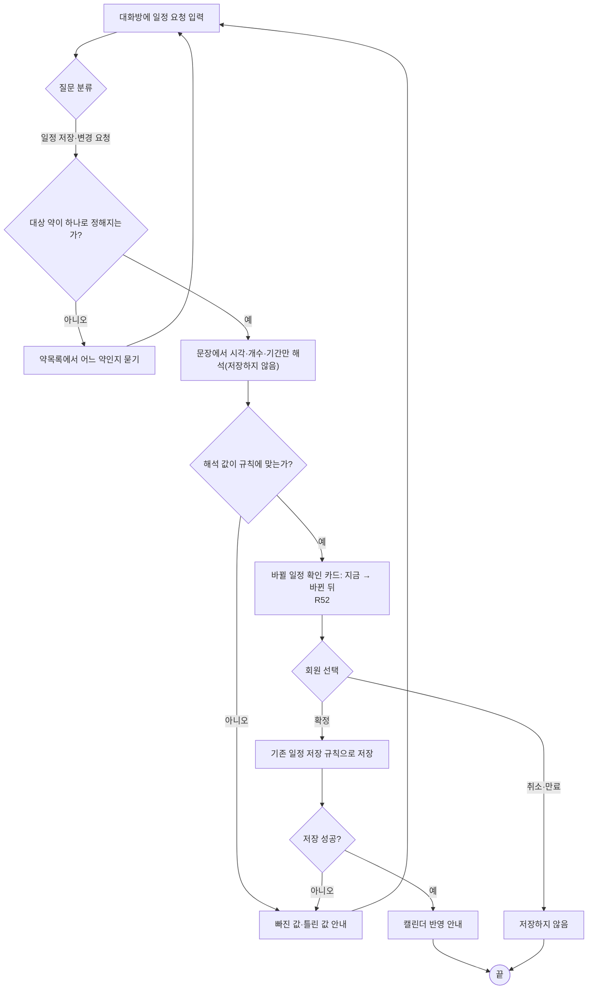

## V3-FL-24 카카오 지인 첫 연결

목적: 웹 로그인 없는 지인을 약봉이 계정 아래 자기 프로필 하나에 연결함(DEC-003·011·012).

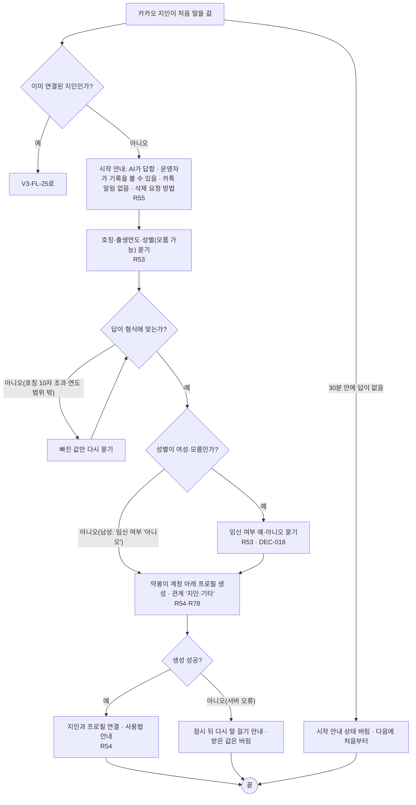

## V3-FL-25 카카오 메시지 묶음 처리

목적: 연속으로 온 글·사진·음성을 한 턴으로 묶어 약봉이 기능에 넘김.

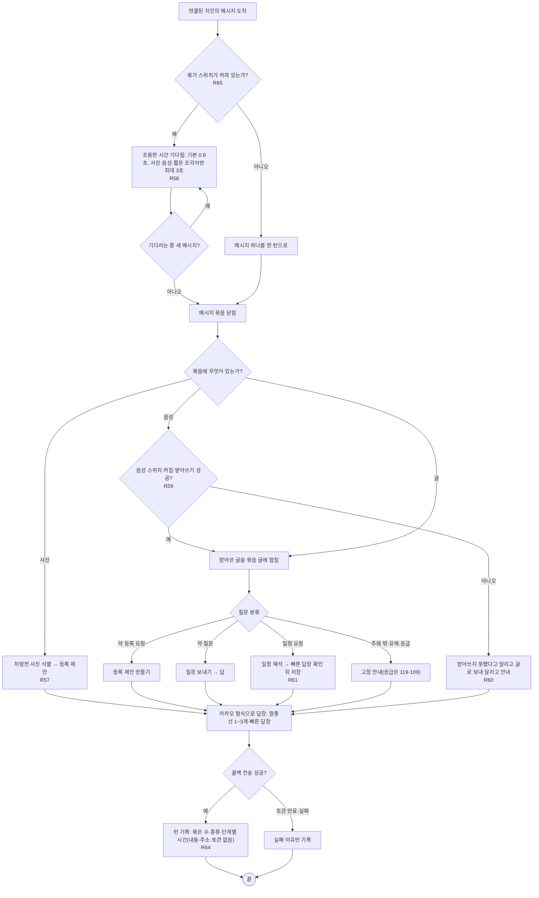

- 사진 속 글자·받아쓴 음성 속 지시로는 저장·삭제·연결 변경을 하지 않음(R62). 응답 목표는 P95 60초(R63)이며 다리 로그로 잼.

## V3-FL-26 카카오에서 등록 제안 확정

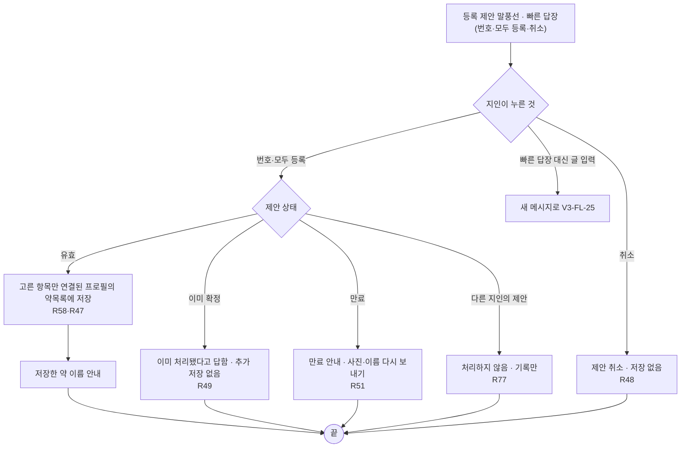

## V3-FL-27 진료 일정 등록·변경·삭제

목적: 가족의 병원 진료 일정과 데려가는 사람을 적음(DEC-010).

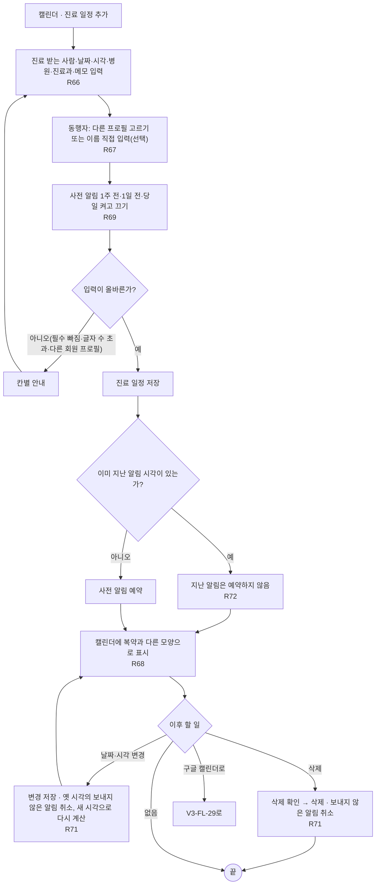

## V3-FL-28 진료 사전 알림 받기

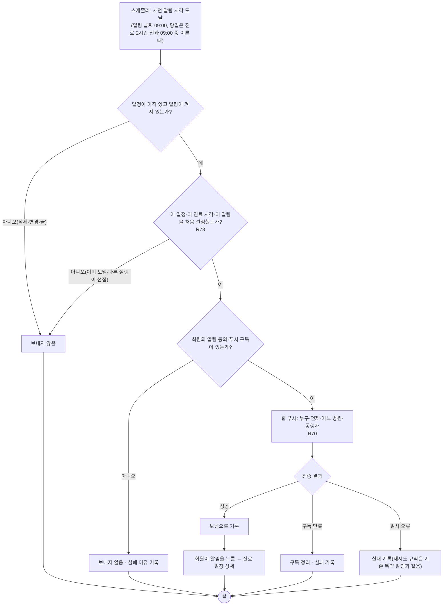

## V3-FL-29 진료 일정을 구글 캘린더로 옮기기

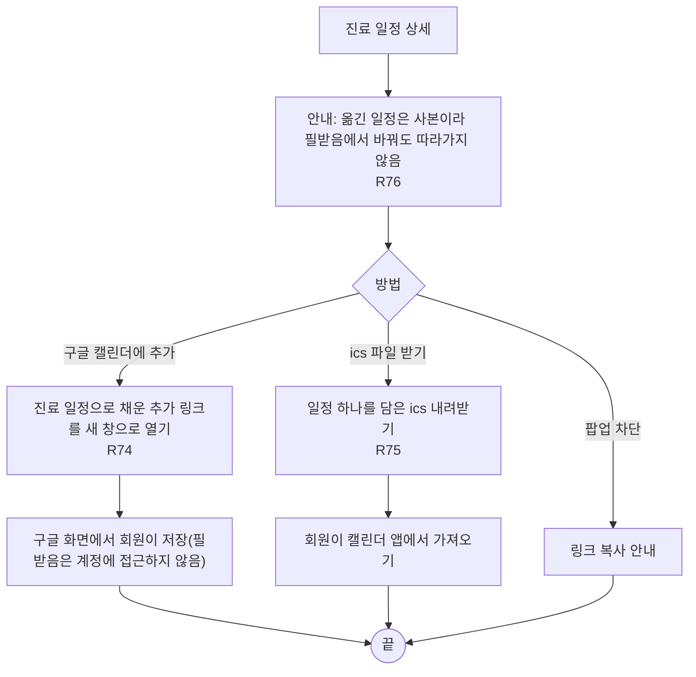

## 바뀌는 기존 흐름

| 기존 흐름(Notion) | 바뀌는 점 | v3 흐름 |
| --- | --- | --- |
| 약 찾기·후보 확인·저장 | 함량을 떼고 찾기, '함량 다름' 후보 표시 | V3-FL-18 |
| 내 약·복약 일정·캘린더 | 목록에서 여러 개 삭제, 시각 +/−, 캘린더에 진료 일정 | V3-FL-17·19·27 |
| AI 상담·근거·실패 후 재시도 | 분류에 '약 등록 요청'·'일정 요청' 추가, 제안 카드 | V3-FL-22·23 |
| 알림 설정·알림에서 예정 약 보기 | 진료 사전 알림이 같은 푸시 구독을 씀 | V3-FL-28 |
| 가입·로그인·프로필 | 관계 선택에 '지인·기타' 추가 | V3-FL-24(카카오), 웹 프로필 화면 |

## 점검 결과

- Must 요구사항이 흐름에 나오는지: V3-REQ-33·35·36·39·40·41·42·45·47·48·49·53·54·55·56·57·58·60·66·68·69·70·71·74는 모두 위 흐름에 있음. 비기능 Must(V3-REQ-62·64·73·77)도 해당 흐름 단계에 표시했고 시험은 12 QA에서 함.
- 흐름에 없는 요구사항: V3-REQ-38(운영자가 한 번 실행하는 기존 약 함량 채우기)과 V3-REQ-79(운영자의 카카오 연결 해제·삭제)는 사용자 흐름이 아니라 기능 명세에서만 다룸. V3-REQ-63(응답 시간)은 측정 기준이라 흐름에 주석으로만 둠.
- 모든 판단에 갈래가 있고 모든 흐름에 끝(`끝`)이 있음. 실패 갈래: 입력 오류, 이미 처리됨, 만료, 다른 사람의 대상, 외부 조회·전송 실패, 인증 만료를 해당 흐름에 둠.
- 닫은 것: V3-FL-24의 임신 여부 질문(H-16)은 DEC-016(2026-11-02)으로 답해 '확인 대기' 표시를 뗌. 남성은 '아니오'로 두고, 여성·모름이면 한 번 물음.
